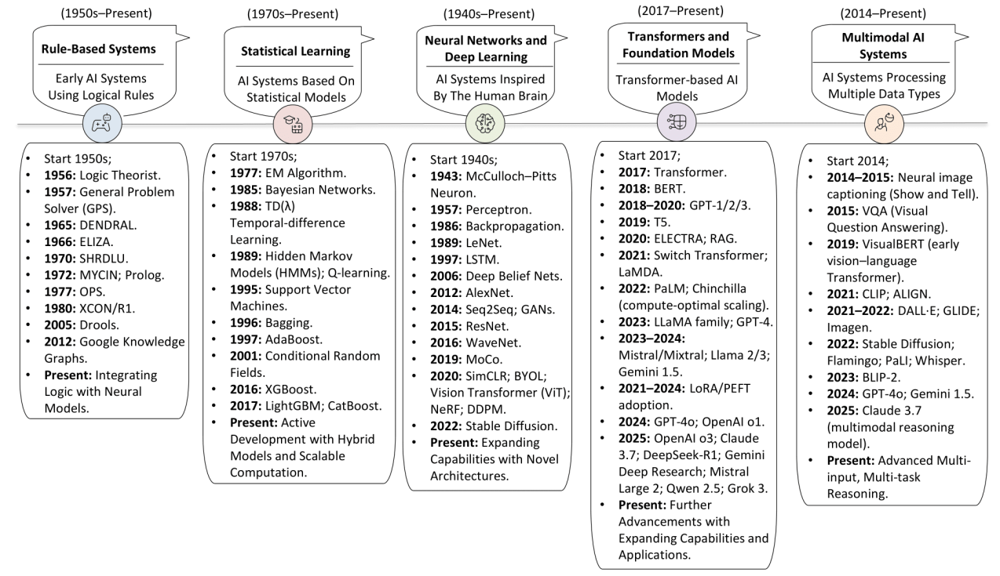
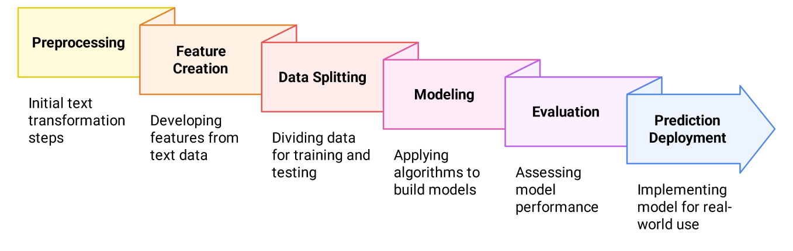

# LLM-NLP-Survey

Evolution, architectures, and open challenges of large language models in natural language processing.

[](https://doi.org/10.1186/s40537-026-01429-1)
[](https://github.com/haseebjaved123/LLM_NLP_JBD_2026)





## What it is

A survey of how NLP moved from rule-based and statistical systems to neural models and transformers, and which open problems remain for large language models.

## Why it matters

The design choice among generative, masked, multimodal, and fine-tuned models changes cost, bias, and what a system can be trusted to do. The survey maps that landscape.

## Method

The paper traces architectural families, including transformer, masked, generative, multimodal, and fine-tuned models, and discusses bias, interpretability, compute cost, and access. Figure 1 is the architecture timeline. Figure 2 is the end-to-end NLP model-development workflow.

## Citation

```bibtex
@article{javed2026llmnlsurvey,
  title={Large language models in NLP: evolution, architectural trends, and open challenges},
  author={Javed, Haseeb and Shah, Babar and Ali, Farman and Kwak, Daehan},
  journal={Journal of Big Data},
  volume={13},
  number={1},
  year={2026},
  doi={10.1186/s40537-026-01429-1}
}
```

## License

MIT for this repository. The article is published by Springer Nature.
